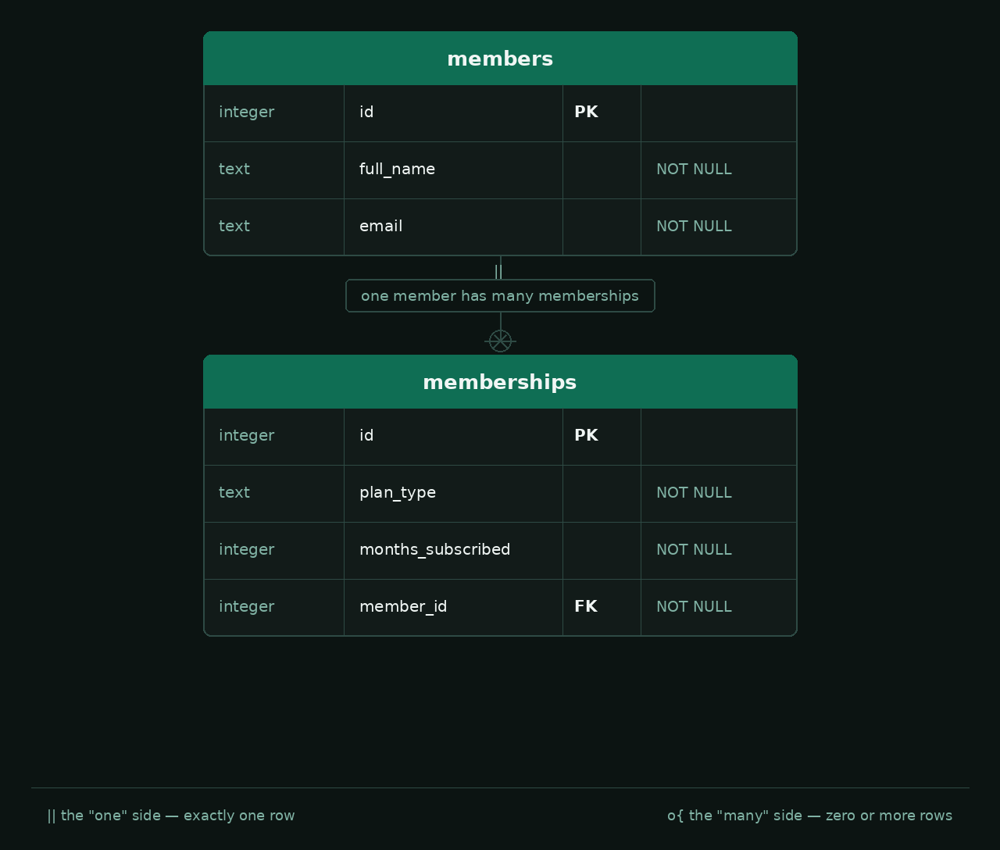

# Formative Assessment

## Learning Outcomes

| Learning Outcome | Section |
|---|---|
| Build Pipelines / Scripting | Section 1 |
| OOP | Section 2 |
| Relational Database Design | Section 3 |

---

## Duration

**Total time: 2 hours 30 minutes**

| Section | Recommended Time |
|---|---|
| Section 1 — Build and Release Management | 50 minutes |
| Section 2 — Practical Implementation | 55 minutes |
| Section 3 — Database Schema Design | 45 minutes |

---

## Scoring

| Section | Marks |
|---|---|
| Section 1 — Build and Release Management | 21 |
| Section 2 — Practical Implementation | 20 |
| Section 3 — Database Schema Design | 20 |
| **Total** | **61** |

---

# Section 1 — Build and Release Management

## Scenario

You have joined a team whose Java application has, until now, been released by
copying a jar off whichever laptop last had a working build. The team wants to move
to Maven and a shared pipeline instead, and you have been asked to explain the
reasoning behind the change before it is rolled out.

Write your answers in `answers.txt`, under the matching question heading. Do not
change the format of the file or create a new one.

| Task | Marks | What earns marks |
|---|---|---|
| Q1.1 — Two laptops, two results | 5 | Identifies three distinct causes rooted in the build not being reproducible (3), explains what a shared automated build gives the team instead (2) |
| Q1.2 — The release process | 5 | Correct order of the four steps (1), correctly distinguishes packaging from deployment (2), explains why compiled class files alone are not something a user can run (2) |
| Q1.3 — Dependencies and the pom | 5 | Accurate description of what `pom.xml` is for (2), correctly explains what the three coordinates identify and what a dependency is (1), explains why dependencies are declared in the pom rather than each developer sourcing them manually (2) |
| Q1.4 — Versioning a release | 6 | Correct version number and sound reason for **(a)** (2), for **(b)** (2), and for **(c)** (2) |

---

### Q1.1 — Two Laptops, Two Results *(5 marks)*

One developer packages the application on their laptop and hands the jar to a
teammate, who runs it without issue. Two weeks later, a different developer checks
out the same commit, packages it on their own laptop, and the jar fails to start.

Explain what could cause a release built from the same source code to behave
differently depending on which machine built it, and what a shared, automated build
gives the team instead.

> Identify at least three distinct causes.

---

### Q1.2 — The Release Process *(5 marks)*

Below are four steps of a release, listed in the wrong order:

```
package the application
compile the source code
deploy the application
run the automated tests
```

State the correct order of these four steps. Then explain what it means to
**package** an application and what it means to **deploy** it, and why the compiled
class files on their own are not something you can hand to a user to run.

---

### Q1.3 — Dependencies and the pom *(5 marks)*

The application uses a library the team did not write. The library's jar is not
committed to the repository, yet every developer's build ends up with it. This is the
only place it is mentioned:

```xml
<dependency>
    <groupId>org.xerial</groupId>
    <artifactId>sqlite-jdbc</artifactId>
    <version>3.53.2.1</version>
</dependency>
```

Explain what `pom.xml` is for, what a dependency is in this context, and what the
`groupId`, `artifactId` and `version` each identify. Then explain why dependencies are
declared here rather than each developer downloading the jars themselves.

---

### Q1.4 — Versioning a Release *(6 marks)*

The application is currently released at version `3.1.4`.

Each of the following changes is made **independently**, starting from `3.1.4` in every
case. For each one, state the new version number and explain why:

- **(a)** You fix a bug that threw an exception when a list happened to be empty. No
  public API changes.
- **(b)** You change the return type of an existing public method from `int` to
  `long`.
- **(c)** You add a new overloaded method that offers an optional extra parameter,
  while the existing method keeps working exactly as before.

---

# Section 2 — Practical Implementation

## Scenario

You have taken over the starter project in this repository, a small gym membership
service. Different kinds of membership charge their total cost differently and
require different notice periods to cancel. `MonthlyMembership` and
`AnnualMembership` are both fully implemented.

The build is currently broken, and the project does not compile.

| Task | Marks | What earns marks |
|---|---|---|
| Q2.1 — Fix the build | 10 | Correctly identifies and adds the missing dependency using its Maven Central coordinates (5), dependency declared with the correct scope (2), and — with Q2.2 also complete — `make package` succeeds and produces a jar that runs with `java -jar` (3) |
| Q2.2 — Fix the OOP structure | 4 | Correctly identifies why `Membership` does not compile (2), restores it as an abstract class, leaving the two method declarations and the subclasses' logic untouched (2) |
| Q2.3 — Build a pipeline | 6 | Correct `stages` defined in the correct order (2), `test` job correctly defined in its own stage and runs the matching Makefile target (2), `package` job correctly defined in its own stage, runs the matching Makefile target and keeps the jar as an artifact (2) |

---

### Q2.1 — Fix the Build *(10 marks)*

A certain missing dependency is preventing this project from building correctly. Find
the correct dependency and add it to `pom.xml` so that `make package` succeeds and
produces a runnable jar.

> You can search for artefacts on [Maven Central](https://mvnrepository.com/repos/central).
>
> `pom.xml` marks the spot. Read the build output carefully too — it names what it cannot find.

---

### Q2.2 — Fix the OOP Structure *(4 marks)*

`Membership` is meant to be an abstraction. It holds the state and behaviour that
every membership shares, but it cannot work out a total cost or a cancellation notice
period on its own — only `MonthlyMembership` and `AnnualMembership` can do that, and
each does it differently. As it stands, `Membership` does not compile.

Analyse `Membership` and apply the fix so that the project compiles. Leave the two
method declarations as they are, and do not change any of the cost or notice-period
logic in the subclasses.

> You may not modify the tests.
>
> This should take no more than 5 minutes.

---

### Q2.3 — Build a Pipeline *(6 marks)*

This project builds using GitLab CI. The pipeline is defined in `.gitlab-ci.yml` and
runs against the same `Makefile` targets you would use locally: `make compile`,
`make test`, and `make package`.

The image and the `compile` job are provided as a worked example. Define the
`stages` for this pipeline, and add a job for each remaining stage, so that once
pushed, the pipeline compiles the code, runs the test suite, and then packages the
application, keeping the built jar as a pipeline artifact.
> You are allowed to use the following [CI/CD docs](https://docs.gitlab.com/ci/yaml/).

---

# Section 3 — Database Schema Design

## Scenario

The gym service currently only prints to the console. The next step is to persist
`members` and `memberships` in a real database. `resources/erd.png` is the entity
relationship diagram for the two tables you need to create:



A `Database` class is already provided and knows how to open a JDBC connection to a
SQLite database. `DatabaseSchema.createSchema(Connection connection)` is where the
schema itself is created, but the method body is currently empty.

> `resources/SQL-Cheat-Sheet.pdf` is provided as a reference if you need a refresher
> on SQL syntax (data types, constraints, `CREATE TABLE`, etc.).

| Task | Marks | What earns marks |
|---|---|---|
| Q3.1 — Create the `members` table | 8 | Correct columns and types (4), `id` declared as the primary key and `full_name`/`email` declared `NOT NULL` (4) |
| Q3.2 — Create the `memberships` table | 8 | Correct columns and types (4), `id` declared as the primary key and `plan_type`/`months_subscribed`/`member_id` declared `NOT NULL` (4) |
| Q3.3 — Foreign key | 4 | `memberships.member_id` correctly declared as a foreign key referencing `members.id` (4) |

---

### Q3.1 – Q3.3 — Create the Schema *(20 marks)*

Implement `DatabaseSchema.createSchema(Connection connection)` so that it creates the
`members` and `memberships` tables exactly as shown in the ERD, using standard SQL
`CREATE TABLE` statements executed through the JDBC `Connection` you are given.

> This task is schema creation only — you are not inserting or querying any data.
>
> Run `mvn test` to check your schema against `DatabaseSchemaTest`.

---

### End of Assessment

---

## Project structure

```
gym-assessment/
  README.md
  answers.txt
  pom.xml
  Makefile
  .gitlab-ci.yml
  resources/
    erd.png
    SQL-Cheat-Sheet.pdf
  src/
    main/java/za/co/wethinkcode/gym/
      Membership.java
      MonthlyMembership.java
      AnnualMembership.java
      Main.java
      Database.java
      DatabaseSchema.java
    test/java/za/co/wethinkcode/gym/
      MembershipTest.java
      MonthlyMembershipTest.java
      AnnualMembershipTest.java
      DatabaseSchemaTest.java
```

## Useful commands

```bash
# Compile the source code
mvn compile

# Resolve and download every declared dependency
mvn dependency:resolve

# Run the test suite
mvn test

# Package the application into a jar
mvn package -DskipTests

# Run the packaged jar
java -jar target/gym-assessment-jar-with-dependencies.jar
```

The `Makefile` wraps the same commands, and is what the GitLab CI pipeline runs:

```bash
make compile
make test
make package
```

Each section can be completed independently. `make package` does not run the test
suite, so Section 2 can be finished and checked before you start Section 3. Once all
three sections are complete, a plain `mvn package` will also succeed.
